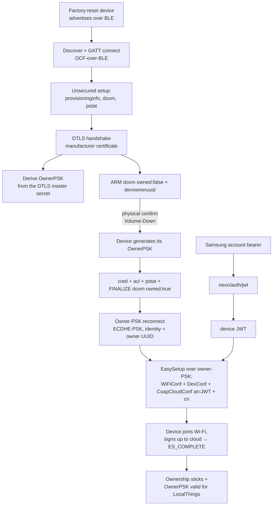

# 01 — Overview

## The goal

Get the **`OwnerPSK`** for a Samsung OCF appliance so a local integration (Home Assistant
LocalThings) can control it over the LAN, **without rooting a phone or restoring an iOS
backup** — the only two routes the community had documented.

## The result

A standalone, unrooted Android app performs the device's own **manufacturer-certificate
Ownership Transfer**, derives the `OwnerPSK` from that handshake, and then drives the device
through **EasySetup** so it joins Wi-Fi and registers to SmartThings. Verified on one
HW-Q950A soundbar:

- Ownership **persists** (`/oic/sec/doxm` reports `owned:true` with our owner UUID).
- The device **registers in SmartThings** (appears in the account; `ES_COMPLETE`).
- The derived key **authenticates a real local session**: using the same
  `smartthings-local` library Home Assistant uses, `GET /oic/d → 2.05 Content` returns the
  soundbar's identity and `/oic/res` lists its `/sec/networkaudio/*` control resources.

## The pipeline

## The two carriers, and the one physical step

- **Onboarding carrier:** a *manufacturer certificate* DTLS session (ECDHE-ECDSA). This is how
  the device proves it's genuine and how ownership is transferred. It is used **only during
  setup**.
- **Runtime carrier:** the **`OwnerPSK`** (ECDHE-PSK). Everything after ownership — including
  the EasySetup writes and all later local control — rides a PSK session keyed on the owner
  UUID.
- **One human action:** the device withholds its ownership commit until a **physical confirm**
  (on the soundbar, a Volume-Down press). This is the manufacturer "confirmed" OXM; it's what
  stops a drive-by from silently taking a device.

## What had to be true for it to work

Three non-obvious things, each of which silently produced a *wrong but plausible* key until
fixed (details in [`04`](04-ownerpsk-derivation.md)):

1. **The master secret must be captured live.** BouncyCastle zeroes the DTLS master secret
   before you can read it post-handshake, so the key was derived from 48 zero bytes.
2. **The right OXM label.** This soundbar derives with `oic.sec.doxm.mfgcert`, not the
   `x.org.iotivity.conmfgcert` some references use.
3. **Ownership only sticks after `ES_COMPLETE`.** Without the cloud sign-up the device rolls
   ownership back when the session closes — so EasySetup (and the device JWT it needs) is part
   of *acquisition*, not an afterthought.
