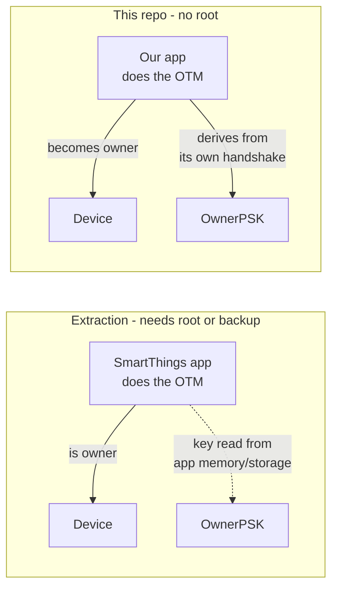

# 02 — OCF ownership and the `OwnerPSK`

## The key is never on the wire

An OCF device and the party onboarding it establish a shared secret — the **`OwnerPSK`** —
during the Ownership Transfer Method (OTM). Crucially it is **derived, not exchanged**: both
sides compute the same 16 bytes from the DTLS session's randoms and master secret plus the two
party UUIDs (see [`04`](04-ownerpsk-derivation.md)). Nothing carrying the key crosses the
network.

That single fact shapes everything:

> To **know** the `OwnerPSK` you must either **be a party to the ownership handshake**, or
> **read it out of a party that already did** (its memory, storage, or a backup).

The community's documented routes are all the second kind — Frida on a rooted phone, or an
iOS backup of the SmartThings app. They work, but they need that privileged access. The only
way to avoid it is the first kind: **do the ownership handshake yourself.**

## "No root" forces you to become the owner

When our app runs the OTM, **our** UUID becomes the device's OCF owner and **we** derive the
key with no spying. The trade is that the device's OCF owner is now us, not SmartThings.

## Does that break SmartThings?

"OCF owner" is a *local* role. After taking ownership we still run EasySetup so the device
**signs itself up to the user's SmartThings cloud account** (`ES_COMPLETE`). So:

- The device still appears in SmartThings and cloud control works. On the tested unit it
  showed up as an **"External" device** but was fully controllable.
- We hold the local `OwnerPSK` for LocalThings.

The caveat worth repeating: modern SmartThings sometimes talks to devices *locally* too, and
that path expects *it* to be the owner. On the tested soundbar nothing broke, but this is the
one behaviour to verify per model. The gentler alternative — an *additive least-privilege
peer* credential where Samsung stays owner — needs you to already hold an owner credential, so
it isn't simpler for a fresh device.

## The four UUIDs you must not conflate

OCF onboarding juggles several identities. Keeping them distinct avoids most confusion:

| UUID | What it identifies | Where it shows up |
|---|---|---|
| **Server-certificate subject** | the device's manufacturer cert identity | the DTLS cert during OTM |
| **OCF device UUID (`di`)** | the device itself | `/oic/d`, `/oic/sec/doxm` `deviceuuid` |
| **OCF owner UUID** | whoever took ownership | `doxm.devowneruuid`, `cred.rowneruuid`; this is the **PSK identity** |
| **Pairwise-peer UUID** | an additive non-owner credential (fridges/Frame) | not derivable from DOXM |

For an `OwnerPSK` session the **identity you present is the owner UUID**, and the device looks
up the matching `cred` entry. (`PskAuth(identity=owner_uuid.bytes, key=owner_psk)`.)

## Credential type vs ownership method

Two `doxm` fields are easy to mix up:

- **`oxms`** — *ownership-transfer methods* the device accepts, e.g. `[1, 2, 65282]`
  (random-PIN, manufacturer-certificate, vendor confirmed-mfgcert). This answers *how
  ownership can be taken*.
- **`sct`** — the *supported credential-type* bitmask (bit 0 = symmetric pairwise key). This
  is capability metadata, **not** proof of which credential is installed.

A device can report `sct: 1` (PSK runtime) **and** `oxms` containing `2` (manufacturer-cert
onboarding) at once — which is exactly the soundbar here, and why "media devices have no
manufacturer certificate" turned out to be wrong for this unit.
