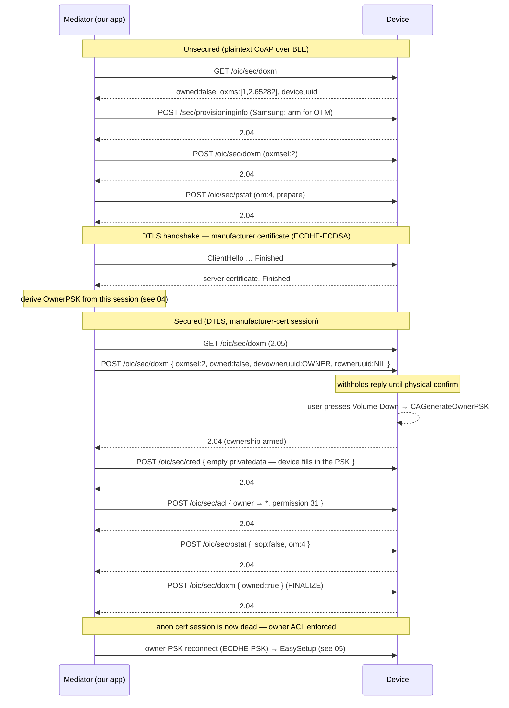

# 03 — The manufacturer-certificate OTM, on the wire

This is the exact sequence that owns the device, reconstructed from a plaintext capture of a
real onboarding and reproduced by the reference app. All resources are OCF security resources
under `/oic/sec/*`; payloads are CBOR. Identifiers are placeholders.

## Sequence



## The payloads

OXM selection is **`oxmsel: 2`** (manufacturer certificate). The two-phase `doxm` is the heart
of it: first **arm** with `owned:false`, which the device answers only after the physical
confirm, then **finalize** with `owned:true`.

**Arm `doxm`** (the device defers its response here until the button press):
```json
{ "oxmsel": 2, "owned": false,
  "devowneruuid": "<OWNER_UUID>", "rowneruuid": "00000000-0000-0000-0000-000000000000" }
```

**Owner credential** — note the **empty** `privatedata`: you do *not* send the key. The device
generated its own `OwnerPSK` at the confirm step and fills this record in; you derive the same
value independently.
```json
{ "creds": [ { "credid": 10, "subjectuuid": "<OWNER_UUID>", "credtype": 1,
               "privatedata": { "encoding": "oic.sec.encoding.base64", "data": "" } } ],
  "rowneruuid": "<OWNER_UUID>" }
```

**Owner ACL** — wildcard resource, full permission (31):
```json
{ "aclist": { "aces": [ { "subjectuuid": "<OWNER_UUID>",
    "resources": [ { "href": "*", "rt": ["*"], "if": ["*"] } ], "permission": 31 } ] },
  "rowneruuid": "<OWNER_UUID>" }
```

**`pstat`** before finalize, then **finalize `doxm`** `{ "owned": true }`.

## Two things that cost us runs

- **The physical confirm is a real device-side gate.** The device holds the response to the
  *arm* `doxm` open (seconds) until the button is pressed, then replies `2.04`. An automated
  flow must wait for that deferred response, not assume an immediate answer.
- **The anonymous cert session dies at finalize.** Once `owned:true` is written the device
  enforces the owner ACL, so the manufacturer-cert session can no longer write. Everything
  after finalize — `pstat` ordering aside, and all of EasySetup — must ride a **fresh
  owner-PSK session** (see [`05`](05-easysetup-and-cloud.md)). Reaching `ES_COMPLETE` is what
  makes ownership **persist**; without it the device reverts to `owned:false` on disconnect.
