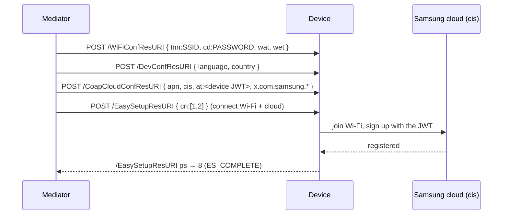
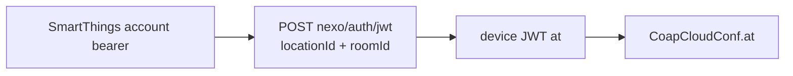

# 05 — EasySetup and reaching `ES_COMPLETE`

Owning the device is not enough. Its control application (`/sec/networkaudio/*` on the
soundbar) only serves once the device has **registered and published its resources to a
cloud** — `ES_COMPLETE`. And ownership itself only **persists** after that point; without it
the device reverts to `owned:false` on disconnect. So EasySetup is part of *acquisition*.

`ES_COMPLETE` is reported by `/EasySetupResURI` as `ps`:

| `ps` | meaning |
|---|---|
| 0–3 | init / Wi-Fi join |
| 4 | registering to cloud |
| 5 | registered |
| 7 | publishing resources |
| **8** | **ES_COMPLETE** — control app live |

## The owner-PSK reconnect

The finalize (`owned:true`) kills the manufacturer-cert session, so EasySetup rides a **fresh
owner-PSK session**:

- Ciphersuite **`TLS_ECDHE_PSK_WITH_AES_128_CBC_SHA256` (`0xC037`)**.
- **Identity** = owner UUID, raw 16 bytes. **Key** = the derived `OwnerPSK`.

Then, over that session, the EasySetup writes:



`CoapCloudConf` (placeholders) carries the cloud endpoints plus a device access token and
Samsung-specific fields:
```json
{ "ac": "", "apn": "coaps+tcp://connect.samsungiotcloud.com",
  "at": "<DEVICE_JWT>", "att": 0, "cis": "coaps+tcp://<cloud-shard>:443",
  "x.com.samsung.clientid": "<ST_CLIENT_ID>", "x.com.samsung.uid": "<SA_UID>",
  "x.com.samsung.iatt": 2, "x.com.samsung.deployenv": "PRD",
  "x.com.samsung.sadsc": "<DEVICE_SECCODE>", "x.com.samsung.refreshtoken": "" }
```

## The device JWT — the one piece that needs a cloud call

`at` is a short-lived **device JWT** that authorizes the device to sign up under the account.
It is minted by the SmartThings cloud:

```
POST https://client.smartthings.com/nexo/auth/jwt
Authorization: Bearer <SmartThings account bearer>
{ "locationId": "<LOCATION_ID>", "roomId": "<ROOM_ID>", "scope": ["iot.device"] }
→ { "jwt": "<DEVICE_JWT>", "authprovider": "...", "redirecturi": "..." }
```

Useful properties:
- The request body is just **`locationId` + `roomId` + `scope`**. `locationId`/`roomId` are
  account-stable; you read them once from the account.
- The **`physicalId` is assigned by the cloud per call** (it differs every time) — you do *not*
  supply it. So a fresh JWT can be minted any time from a bearer + the two IDs.
- The JWT is short-lived (~minutes). Mint it **in-app, immediately before** the EasySetup
  write, not ahead of time.



## One login is enough

Two `CoapCloudConf` fields look like they need a separate Samsung device-login:
`x.com.samsung.uid` and `x.com.samsung.sadsc` (a device sec-code). Testing showed neither does:

- The minted **device JWT already carries the account uid** — its payload is
  `{"uid":"<SA_UID>","locationId":…,"roomId":…,"scope":["iot.device"],"physicalId":…}` — so
  `x.com.samsung.uid` is read straight from the JWT, with no extra login.
- **`sadsc` can be empty.** A full registration to `ES_COMPLETE` (device appears in the account)
  succeeds with `x.com.samsung.sadsc: ""`. The sec-code is not required.

So the whole flow needs **one** sign-in — the SmartThings web login for the bearer — and nothing
from Samsung's first-party device OAuth.

## The bearer — obtained no-root

`nexo/auth/jwt` needs a **SmartThings account bearer**. The app can't *mint* one (Samsung's
first-party account OAuth has its `client_id`/`client_secret` injected at runtime, unavailable
to third parties) — but it doesn't need to. The reference app **harvests the bearer from your
own SmartThings web sign-in** in an in-app WebView: no root, no system CA, no proxy — you are
only reading your own session.

The web dashboard (`my.smartthings.com`) is **cookie-authenticated**, not bearer-in-a-header.
Hooking `fetch`/`XHR` for an `Authorization` header captured nothing (the dashboard's API
calls carry no such header), and web storage held only UI data. The session lives in cookies
on `.smartthings.com`:

| cookie | what it is |
|---|---|
| **`_JTKN`** | the SmartThings **JWT** — this *is* a usable account bearer (~1.7 kB, `eyJ…`) |
| `_SA_TOKEN` | Samsung-account token (not accepted as a bearer → `401`) |
| `cake_session` / `_csrf` | the web app's server session |

So the app reads its own WebView cookie jar (`CookieManager`), pulls `_JTKN`, and **validates
it** against `auth-global.api.smartthings.com/users/me` (expect `200`) before accepting it —
only then does the sign-in screen close. That token drives `nexo/auth/jwt` and the
`/v1/locations | rooms | devices` calls directly.

(The original *reverse engineering* instead read a bearer from the SmartThings **app's** TLS via
a system-CA mitmproxy, which required root. The in-app cookie-jar read is what removed that last
root dependency. The app's bearer was a short opaque token; the web `_JTKN` is a JWT — both
authorize the same APIs.)

## Confirming success

The device-side `ps → 8` is read back over BLE, but the device usually drops the BLE link the
moment it joins Wi-Fi, so that read is unreliable. The robust signal is **cloud-side**: snapshot
`/v1/devices` before onboarding and poll it after — when the new device appears in the account,
registration genuinely completed. Once there: ownership sticks and the `OwnerPSK` is live for
local control.
