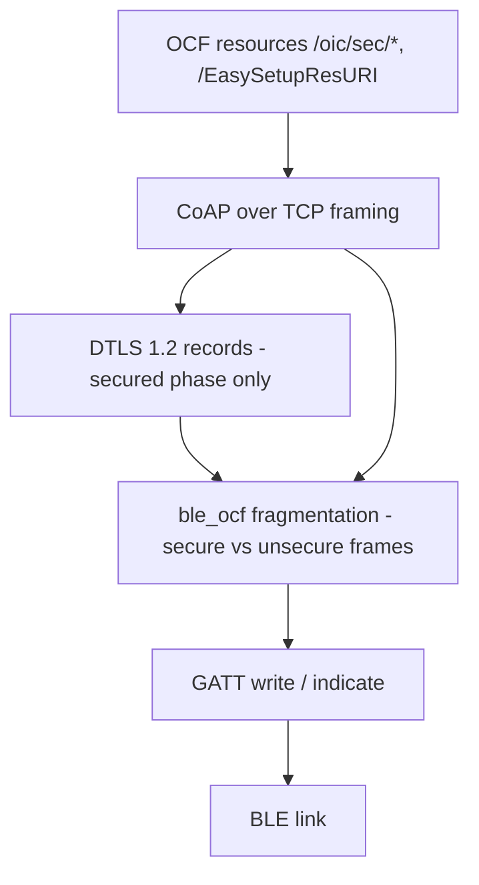

# 06 — OCF over BLE: the transport

Before any of the security dance, you have to *talk* to a factory-reset device. It isn't on
Wi-Fi yet, so onboarding happens over **BLE**, with OCF's CoAP/DTLS tunnelled through a GATT
characteristic. This is the layer that carries everything in docs [03](03-otm-sequence.md)–[05](05-easysetup-and-cloud.md).

## Stack

## Discovery and connect

- The device advertises as an OCF peripheral (e.g. `[AV] Samsung Soundbar …`). Match it, GATT
  connect, discover services, negotiate the MTU. We request 247, but the device may negotiate
  far higher — a Pixel 10 Pro XL goes to **517** — which matters for fragment sizing (below).
- The OCF service exposes a write characteristic and an **indicate** characteristic; enabling
  indications (CCCD) is required before the device will answer.

## Framing

- Requests are **CoAP-over-TCP** PDUs (not UDP CoAP): a length-prefixed CoAP message carrying
  the method, a token, Uri-Path options and the CBOR payload.
- Those PDUs are split into **`ble_ocf` frames** sized to the MTU, with a flag distinguishing
  **unsecured** frames (the plaintext setup phase) from **secured** frames (DTLS records). A
  reassembler on each side rebuilds the PDU.
- During the DTLS phases, each DTLS record is just payload inside secure frames; the handshake
  and all secured CoAP exchanges run over this.

## Fragment size: the 512-byte trap

Size `ble_ocf` fragments as `min(MTU − 3, 512)`, **not** `MTU − 3`.

A GATT attribute value is capped at **512 octets** by the Bluetooth spec (BlueDroid's
`GATT_MAX_ATTR_LEN`). On a phone that negotiated a 517-byte MTU, `MTU − 3 = 514`, so a
full-size fragment exceeds the cap and `BluetoothGatt.writeCharacteristic()` returns `false`
**synchronously, every time** — no callback, no ATT error on the wire.

This only bites **multi-fragment** messages. Short writes (WiFiConf, DevConf) fit in one
sub-512 fragment and always succeed; the only big payload is **CoapCloudConf**, which carries
the ~650-char device JWT and needs two fragments — so cloud registration was the single step
that failed, and only on high-MTU phones. A lower-MTU tablet never hit it. Cap at 512 and it
works everywhere.

Also retry a rejected `writeCharacteristic` a few times with a short delay (holding your
write semaphore, since no callback fires on a rejected write) to ride out the transient
"stack still busy with the previous op" case.

## Two reconnects on one GATT link

A full onboarding runs **two DTLS sessions back-to-back on the same BLE connection**:

1. the manufacturer-certificate session (OTM), then
2. the owner-PSK session (EasySetup).

Between them the first session is closed and the secure-frame reassembly buffer must be
**reset**, or stale records corrupt the new handshake. The GATT link itself stays up.

## Operational notes (things that bit us)

- **`writeCharacteristic rejected`** has two causes. The common one is the 512-byte cap above
  (a code bug, now fixed). The other is a **half-reset or heavily-cycled unit wedging its BLE**:
  it connects and discovers services but rejects the first write (often with `CCCD ack
  timeout`). The cure there is a **power-cycle of the device**; toggling the phone's Bluetooth
  is not enough. Space out onboarding attempts.
- **Signal matters.** The DTLS handshakes are multi-flight; a weak link (RSSI around −80)
  drops records and stalls the handshake. Onboard close to the device.
- The physical **confirm window is short** (seconds). The ARM `doxm` response is withheld until
  the press, so have the device in reach before you start.
