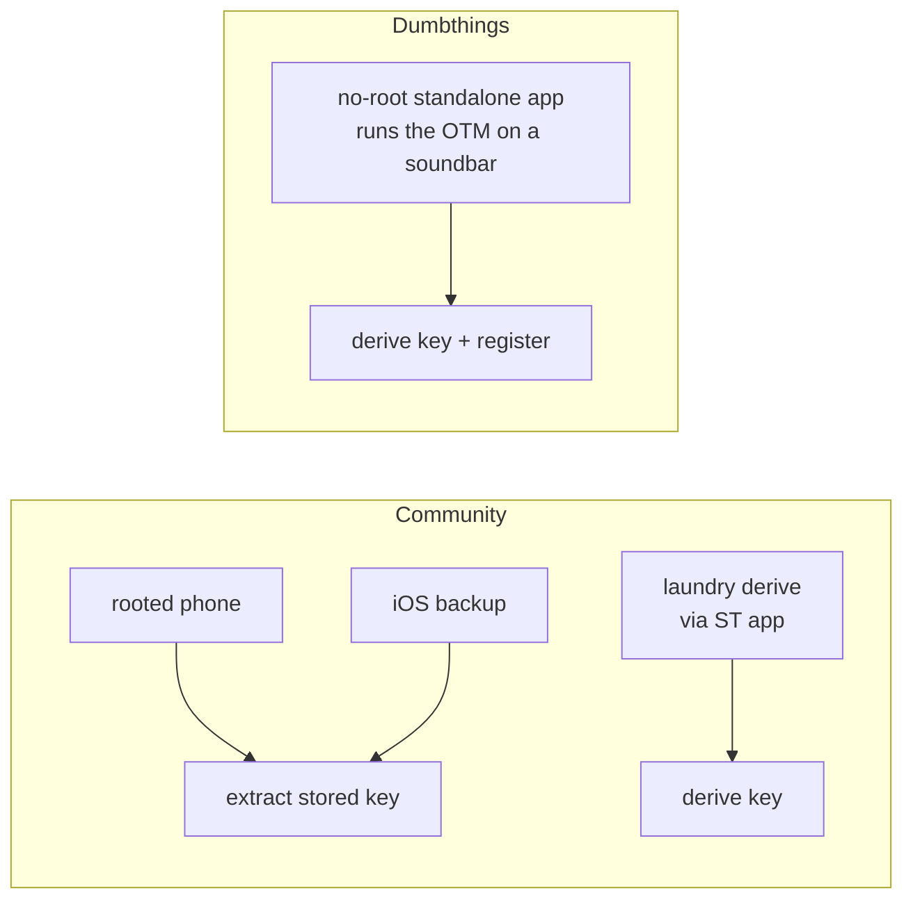

# 07 — Where this fits in the credential-acquisition landscape

The LocalThings integration deliberately **imports an already-provisioned credential** and
does not perform OTM or write `/oic/sec/*`. Acquisition is treated as separate tooling, and
its documented routes are collected in that project's `credential-acquisition.md`. This note
places the Dumbthings method against those routes. (Device classes and findings below are the
community's; the soundbar `oxms`/label evidence is this repo's contribution.)

## Device classes (community)

Classes differ by *authentication carrier*, not appliance family:

| Class | Runtime credential | OCF owner after setup |
|---|---|---|
| Current appliances | client certificate (AC14K_M) | n/a |
| Laundry (WD5x/WD8x) | per-appliance **OwnerPSK** | **replaced** — you become owner |
| Some fridges / Frame TV | additive least-privilege **peer** | Samsung stays owner |
| `sct:1` media (TV, soundbar) | **OwnerPSK** | — |

## Documented acquisition routes (community)

All the *documented* routes are **extraction of a stored key**:

| Route | Devices | Needs root / backup? |
|---|---|---|
| SmartThings remove-and-readd, recover key from the app (Frida) | washer | **rooted phone** |
| Recover OwnerPSK from rooted Android's IoTivity store | oven | **rooted phone** |
| Recover OwnerPSK from an unencrypted iPhone backup | washer, fridge | **iOS backup** |

There are also *undocumented* derive-from-handshake transitions reported on **laundry**
(owner-authorized, non-reset, OwnerPSK derived from manufacturer DTLS — the same family of
technique used here) — but those used the SmartThings app to authorize the transition and were
explicitly **"not yet a portable public acquisition flow."** No media-device OTM route was
documented; media was treated as extraction-only.

## What Dumbthings adds

1. **A no-root OTM acquisition on a *media* device.** The soundbar is `sct:1`, and the working
   assumption was that such devices have no manufacturer-certificate path, leaving only
   extraction. This unit advertises **`oxms:[1,2,65282]`** (manufacturer-certificate OXM `2`
   present) and completes a manufacturer-cert OTM — so the derive-from-handshake route *is*
   open to it. That answers the community's open question ("what `oxms` do the `sct:1` TV and
   soundbar report?") with a concrete data point.
2. **The correct OXM label for this soundbar is `oic.sec.doxm.mfgcert`**, not
   `x.org.iotivity.conmfgcert` (see [`04`](04-ownerpsk-derivation.md)).
3. **The live master-secret capture** needed to feed `derive_mfg_certificate_owner_psk` — the
   gap the Python library flags as "no wired input source."

## Honest limits

- **One unit, one firmware.** Everything is a single HW-Q950A data point.
- **The bearer is borrowed** from the signed-in SmartThings app (account-level OAuth is
  first-party-locked). The OTM/derivation/reconnect/EasySetup are self-contained; the bearer
  is not.
- **You become the OCF owner.** Cloud control survived on the tested unit (shown as "External")
  but that is not guaranteed across models. The additive-peer pattern (Samsung stays owner) is
  gentler where you already hold an owner credential, but isn't simpler for a fresh device.
