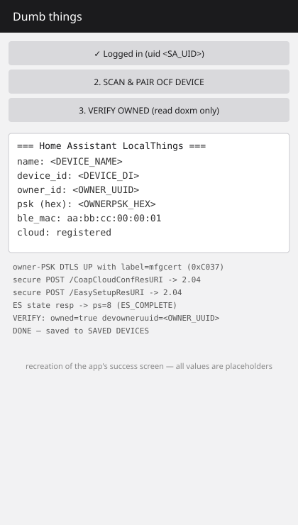

# Screenshots

**No raw screenshots are committed.** The real app screens show the account `uid`, device
UUIDs, MACs, Wi-Fi SSID, bearer fragments, JWTs and the live `OwnerPSK` — too much to redact
reliably in a raster image. Instead this folder holds a **clean recreation**:

- [`app-result-mockup.svg`](app-result-mockup.svg) — the app's successful "result" screen with
  every value replaced by a placeholder.

The real flow is: **SCAN & PAIR → pick device → enter Wi-Fi → Pair + register → press the
device's physical confirm → result**. The result box prints the owner UUID and `OwnerPSK` you
import into LocalThings. See [docs/08](../docs/08-reproduction.md) for the walkthrough.
